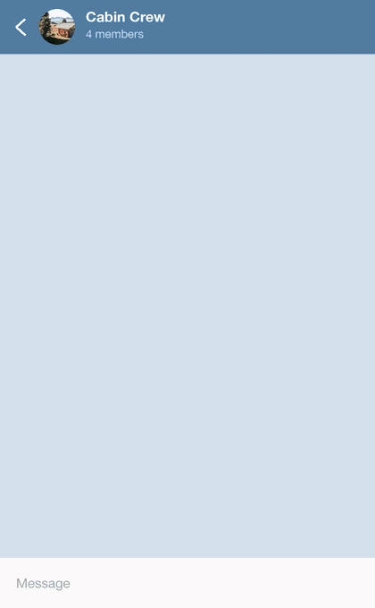

# Assignments

Members can ask Roxi to prepare a set of questions or steps for another member. Roxi sends them one by one in a private chat, collects the answers, and posts the result in the group as a reply to the request.

The assignee must have started a private chat with Roxi first, and can send `/cancel` there to end the assignment early.

  

[Back to the README](../../README.md#features)
