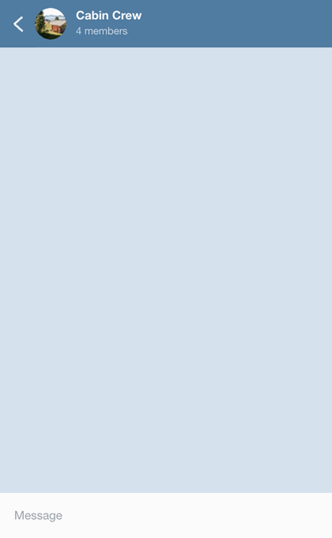

# Reminders

Members can ask Roxi to remind the group about something, once ("on June 11 at 18:00", "in 2 hours") or on a repeating schedule ("every Friday at 10"). At that time, Roxi posts the reminder in the group as a reply to the request. Reminders can be listed and cancelled; only the member who created a reminder or a group admin can cancel it.

Clock times use the group's time zone. The first time someone asks for a reminder at a clock time, Roxi asks which city the group is in. Only a group admin can set it.

  

[Back to the README](../../README.md#features)
